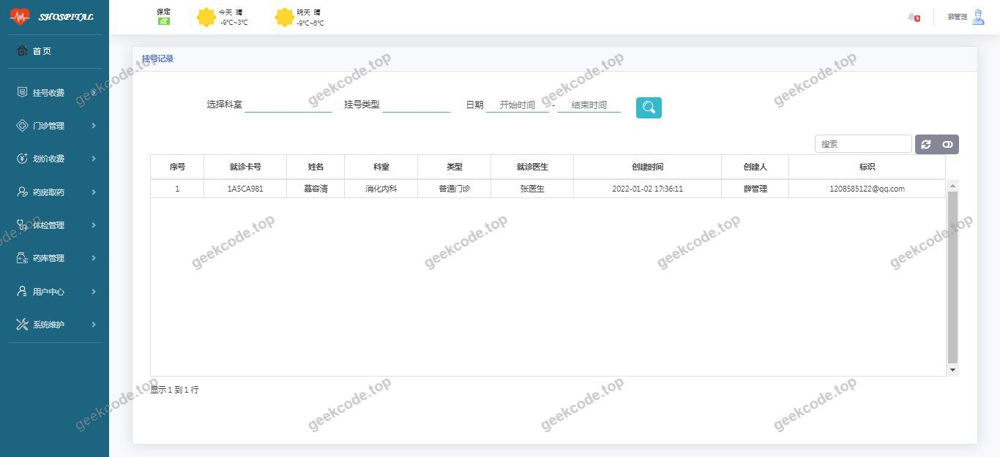
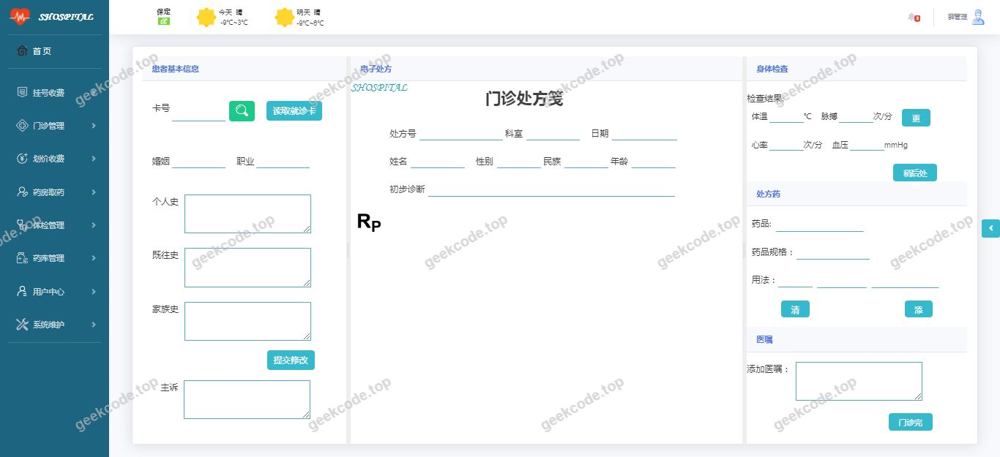
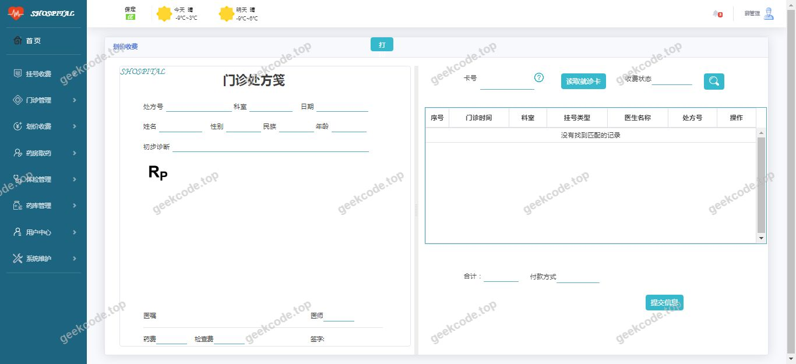
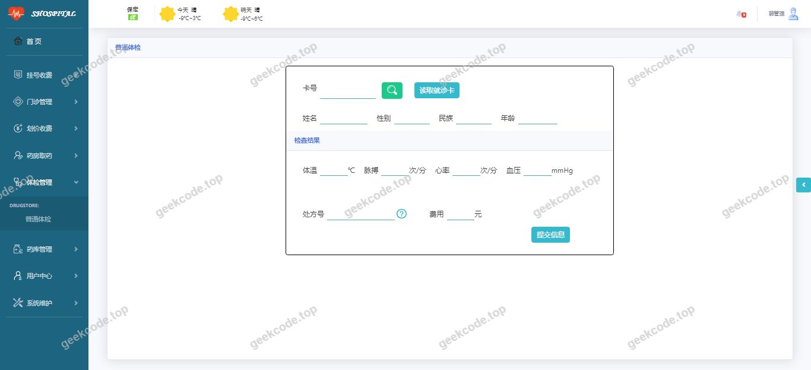
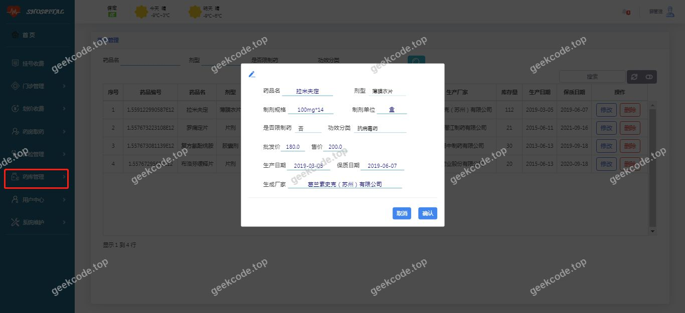
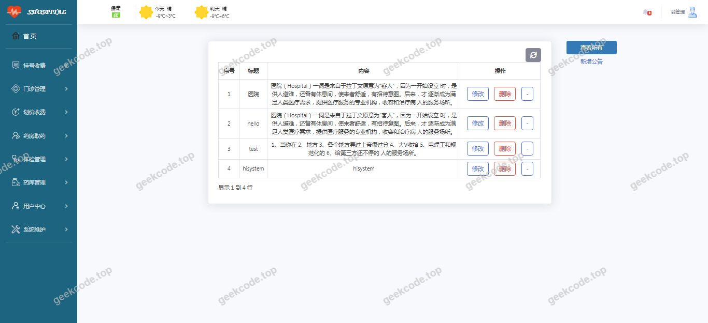
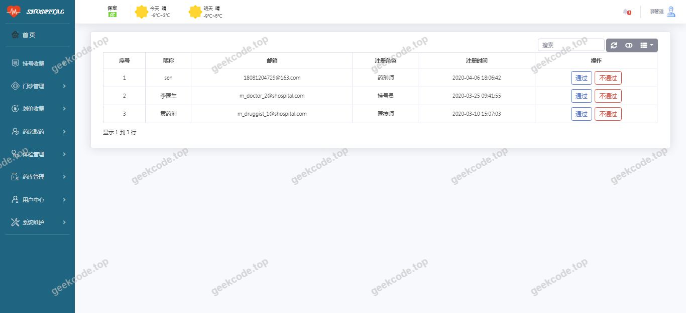

# java精品项目-基于SpringBoot实现的中小医院HIS管理系统

> 🎓 **计算机毕业设计 · java精品项目-基于SpringBoot实现的中小医院HIS管理系统**
>
> 本仓库只放**项目介绍 + 运行截图**（截图是站点带水印的原图，存在仓库 `images/` 里）。
>
> 👉 **完整可运行源码 / 数据库脚本 / 部署文档：[点我获取](https://geekcode.top/archives/java%E7%B2%BE%E5%93%81%E9%A1%B9%E7%9B%AE-%E5%9F%BA%E4%BA%8ESpringBoot%E5%AE%9E%E7%8E%B0%E7%9A%84%E4%B8%AD%E5%B0%8F%E5%8C%BB%E9%99%A2HIS%E7%AE%A1%E7%90%86%E7%B3%BB%E7%BB%9F?utm_source=github)**
>
> 💬 咨询微信：**ir9372**　|　🌐 更多项目：[极客代码 geekcode.top](https://geekcode.top/?utm_source=github)
>
> 📌 项目详情页：<https://geekcode.top/archives/java%E7%B2%BE%E5%93%81%E9%A1%B9%E7%9B%AE-%E5%9F%BA%E4%BA%8ESpringBoot%E5%AE%9E%E7%8E%B0%E7%9A%84%E4%B8%AD%E5%B0%8F%E5%8C%BB%E9%99%A2HIS%E7%AE%A1%E7%90%86%E7%B3%BB%E7%BB%9F?utm_source=github>

<table><td width="230" align="center"> <b>扫码加微信 ir9372</b></td><td valign="middle">📦 源码 = 项目介绍 + 全部运行截图 + 数据库 + 部署文档 👉 点上方任意截图，直接跳到 <b>极客代码 geekcode.top</b> 详情页</td></table>

---

<h1>java精品项目-基于SpringBoot实现的中小医院HIS管理系统</h1>
<h2>项目概述</h2>

本项目为基于 Spring Boot 框架开发的中小医院 HIS（Hospital Information System，医院信息系统）管理系统。旨在通过数字化手段优化中小规模医疗机构的业务流程，提升医疗管理效率与数据安全性。系统核心功能涵盖医院日常运营所需的信息化管理模块，采用前后端一体化架构，利用 Thymeleaf 模板引擎实现页面渲染，结合 Shiro 安全框架保障用户认证与授权。适用人群主要为医院管理人员、医护人员及系统维护人员。技术架构以 Java 语言为基础，依托 MySQL 数据库进行数据存储，具备轻量级、易部署、高稳定性的特点，能够有效支撑中小型医院的日常业务需求。

<h2>技术架构</h2>
<h3>1. 后端架构</h3>

系统后端基于 Spring Boot 框架构建，利用其自动配置特性简化开发流程。核心依赖包括：

<ul>
<li><strong>Web 层</strong>：使用 <code>spring-boot-starter-web</code> 处理 HTTP 请求与响应。</li>
<li><strong>持久层</strong>：集成 <code>spring-boot-starter-data-jpa</code> 和 <code>spring-boot-starter-jdbc</code>，实现对象关系映射（ORM）及底层 SQL 操作，确保数据访问的高效性与规范性。</li>
<li><strong>安全层</strong>：引入 <code>shiro-spring-boot-starter</code> 和 <code>thymeleaf-extras-shiro</code>，实现细粒度的权限控制、会话管理及身份验证机制。</li>
<li><strong>开发辅助</strong>：包含 <code>spring-boot-devtools</code> 用于热部署，提升开发效率；<code>nekohtml</code> 用于 HTML 解析与容错处理。</li>
</ul>
<h3>2. 前端架构</h3>

前端采用 Thymeleaf 模板引擎，属于服务端渲染（SSR）模式。Thymeleaf 能够无缝集成 Spring Boot，支持自然模板语法，使得 HTML 文件可直接在浏览器中预览，同时具备强大的表达式运算能力，便于动态展示后台数据。由于项目未设置独立的前台路由或复杂的 SPA（单页应用）结构，页面交互主要通过表单提交与链接跳转完成，保持了传统 Web 应用的简洁性。

<h3>3. 数据库设计要点</h3>

系统使用 MySQL 作为主要数据存储方案，通过 <code>mysql-connector-java</code> 驱动连接。虽然具体表结构未在上下文中详细列出，但基于 JPA 的使用方式，推测采用了实体类映射策略，遵循第三范式以减少数据冗余，并建立必要的外键约束以保证数据完整性。

<h3>4. 核心技术选型理由</h3>
<ul>
<li><strong>Spring Boot</strong>：生态成熟，社区活跃，适合快速构建企业级应用。</li>
<li><strong>Shiro</strong>：相比 Spring Security，Shiro 更轻量且易于理解，适合中小规模项目的权限管理需求。</li>
<li><strong>Thymeleaf</strong>：与 Spring Boot 官方推荐搭配，无需额外配置即可实现良好的前后端数据绑定，降低了前端开发复杂度。</li>
</ul>
<h2>功能模块</h2>

根据现有源码上下文及截图信息，本系统为纯后台管理系统，无面向患者的前台门户。主要功能模块围绕医院内部业务管理展开：

<h3>1. 系统基础管理模块</h3>
<ul>
<li><strong>用户登录与认证</strong>：提供安全的入口界面，支持账号密码验证。</li>
<li><strong>权限控制</strong>：基于 Shiro 框架，对不同角色的用户实施菜单可见性与操作权限限制。</li>
</ul>
<h3>2. 业务数据管理模块</h3>

<em>(注：具体业务子模块名称需依据实际代码中的 Controller 和 Service 定义确定，此处仅描述通用 HIS 功能范畴)</em>

<ul>
<li><strong>患者信息管理</strong>：录入、查询、修改患者基本档案。</li>
<li><strong>医生/员工管理</strong>：维护医院内部工作人员的信息与排班状态。</li>
<li><strong>诊疗记录管理</strong>：存储与检索患者的就诊历史、处方信息及检查结果。</li>
<li><strong>药品/库存管理</strong>：监控药房物资进出库情况，防止缺货或积压。</li>
</ul>
<h3>3. 系统运行界面展示</h3>

根据提供的“系统运行界面1”至“系统运行界面8”，这些截图展示了上述各模块的实际操作视图，包括但不限于列表页的数据展示、详情页的信息呈现以及表单页的数据录入界面。所有界面均通过 Thymeleaf 动态渲染生成。

<h2>用户角色与权限</h2>

由于项目明确标注“是否有前台: 否”、“是否有后台: 否”（此处通常指无独立的前台门户和传统的复杂后台分离架构，而是整合为一个管理端），且使用了 Shiro 进行权限控制，推测系统存在至少两类角色。具体角色划分如下：

<h3>1. 超级管理员 (Admin)</h3>
<ul>
<li><strong>权限范围</strong>：拥有系统最高权限。</li>
<li><strong>可访问功能</strong>：<ul>
<li>全部业务模块的增删改查（CRUD）。</li>
<li>用户账户的管理（创建、禁用、重置密码）。</li>
<li>角色分配与权限配置。</li>
<li>系统日志查看与数据备份恢复。</li>
</ul>
</li>
</ul>
<h3>2. 普通操作员/医护人员 (Operator/Medical Staff)</h3>
<ul>
<li><strong>权限范围</strong>：受限的业务操作权限。</li>
<li><strong>可访问功能</strong>：<ul>
<li>查看患者基本信息与诊疗记录。</li>
<li>录入新的诊疗数据或更新当前患者状态。</li>
<li>查询药品库存或开方（视具体业务逻辑而定）。</li>
<li><strong>不可访问</strong>：系统设置、用户管理、角色权限配置等核心管理功能。</li>
</ul>
</li>
</ul>

<em>(注：若系统中存在更多细分角色如“药剂师”、“挂号员”，其具体权限边界需参照代码中 <code>@RequiresRoles</code> 或 <code>@RequiresPermissions</code> 注解的具体定义。基于现有信息，以上为最通用的两级权限模型。)</em>

<h2>项目特色与创新点</h2>
<ol>
<li><strong>轻量化架构设计</strong>：摒弃了复杂的前后端分离架构，采用 Spring Boot + Thymeleaf 的一体化方案，减少了 API 接口开发与联调的成本，特别适合资源有限的中小医院场景。</li>
<li><strong>严格的安全管控</strong>：深度集成 Apache Shiro，实现了从身份认证到细粒度权限控制的完整闭环，确保医疗数据的访问安全，符合医疗行业对隐私保护的基本要求。</li>
<li><strong>高效的数据持久化</strong>：结合 JPA 与 JDBC，既利用了 ORM 的开发便捷性，又保留了直接执行 SQL 的性能优势，在处理复杂报表查询或批量数据导入时具备灵活性。</li>
<li><strong>开箱即用的开发体验</strong>：引入 DevTools 实现热部署，大幅缩短了开发调试周期；NekoHTML 的加入增强了页面解析的鲁棒性，提升了系统在非标准 HTML 输入下的稳定性。</li>
</ol>
<h2>部署环境</h2>

为确保系统正常运行，需准备以下软件环境：

<table>
<thead>
<tr>
<th align="left">组件</th>
<th align="left">版本要求/说明</th>
</tr>
</thead>
<tbody><tr>
<td align="left"><strong>JDK</strong></td>
<td align="left">Java Development Kit 8 或更高版本（建议 JDK 1.8+，兼容 Spring Boot 主流版本）</td>
</tr>
<tr>
<td align="left"><strong>MySQL</strong></td>
<td align="left">MySQL 5.7 或 8.0 及以上版本</td>
</tr>
<tr>
<td align="left"><strong>Maven</strong></td>
<td align="left">3.6+ （用于项目依赖管理与打包）</td>
</tr>
<tr>
<td align="left"><strong>IDE</strong></td>
<td align="left">IntelliJ IDEA 或 Eclipse （用于代码开发与调试）</td>
</tr>
<tr>
<td align="left"><strong>操作系统</strong></td>
<td align="left">Windows 10/11, Linux (CentOS/Ubuntu), macOS</td>
</tr>
<tr>
<td align="left"><strong>浏览器</strong></td>
<td align="left">Chrome, Firefox, Edge 等现代主流浏览器</td>
</tr>
</tbody></table>

<strong>启动步骤简述：</strong>

<ol>
<li>安装并配置 MySQL 数据库，创建对应 schema。</li>
<li>修改 <code>application.properties</code> 或 <code>application.yml</code> 中的数据库连接信息（URL, Username, Password）。</li>
<li>使用 Maven 命令 <code>mvn clean package</code> 打包项目，或在 IDE 中直接运行主启动类（Main Application Class）。</li>
<li>启动成功后，通过浏览器访问默认端口（通常为 8080）进入系统登录界面。</li>
</ol>
<h2>五、技术特性</h2>
<ul>
<li>服务端模板渲染（Thymeleaf）</li>
<li>集成 Shiro 权限框架实现角色权限控制</li>
</ul>
<h2>六、功能模块截图</h2>
<h3>前台用户端</h3>
<h4>系统运行界面1</h4>

<h4>系统运行界面2</h4>

<h4>系统运行界面3</h4>

<h4>系统运行界面4</h4>

<h4>系统运行界面5</h4>

<h4>系统运行界面6</h4>

<h4>系统运行界面7</h4>

<h4>系统运行界面8</h4>

---

## 获取完整源码

| 项目 | 说明 |
| --- | --- |
| 项目名 | java精品项目-基于SpringBoot实现的中小医院HIS管理系统 |
| 运行截图 | 本文 8 张（站点带水印原图，仓库 `images/` 目录） |
| 完整源码 | [https://geekcode.top/archives/java%E7%B2%BE%E5%93%81%E9%A1%B9%E7%9B%AE-%E5%9F%BA%E4%BA%8ESpringBoot%E5%AE%9E%E7%8E%B0%E7%9A%84%E4%B8%AD%E5%B0%8F%E5%8C%BB%E9%99%A2HIS%E7%AE%A1%E7%90%86%E7%B3%BB%E7%BB%9F?utm_source=github](https://geekcode.top/archives/java%E7%B2%BE%E5%93%81%E9%A1%B9%E7%9B%AE-%E5%9F%BA%E4%BA%8ESpringBoot%E5%AE%9E%E7%8E%B0%E7%9A%84%E4%B8%AD%E5%B0%8F%E5%8C%BB%E9%99%A2HIS%E7%AE%A1%E7%90%86%E7%B3%BB%E7%BB%9F?utm_source=github) |
| 咨询微信 | **ir9372**（备注：jingpin-yuanma） |
| 更多项目 | [极客代码 geekcode.top](https://geekcode.top/?utm_source=github) |

> 需要源码、部署、改配置、跑不起来等问题，加微信 ir9372 沟通，说明项目名即可。
